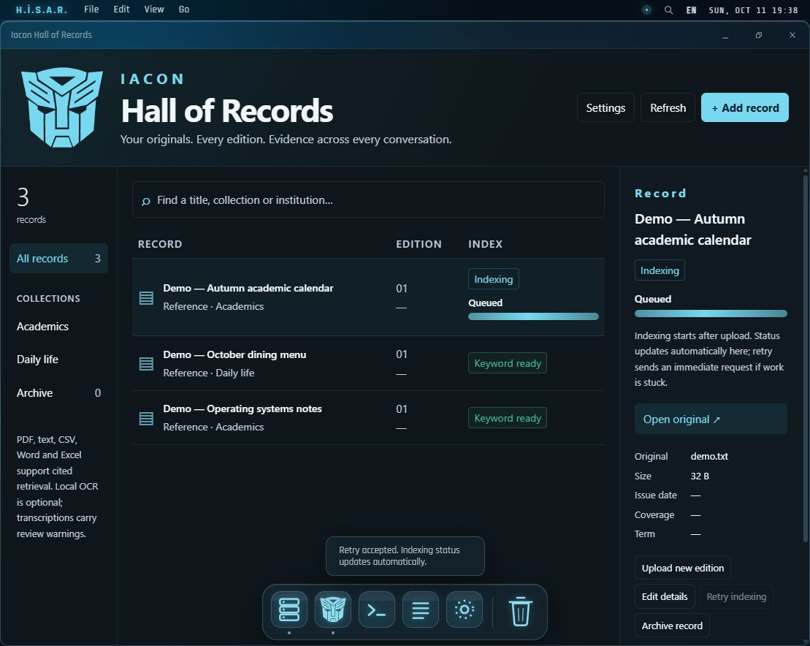
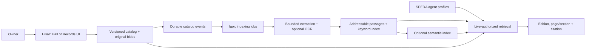
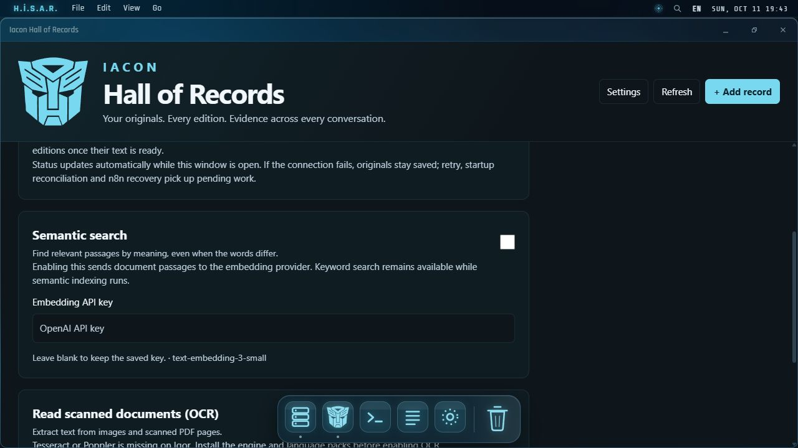

<div align="center">


# IACON · Hall of Records

**Versioned reference documents. Retrieved evidence. Verifiable citations.**

The document retrieval and RAG layer of [SPEDA Mark VI](https://github.com/spedatox/speda-mark6), with a dedicated interface inside [H.İ.S.A.R.](https://github.com/spedatox/hisar).

</div>



## The idea

An assistant should be able to consult an uploaded calendar, syllabus, menu or book in any conversation—and say exactly which edition, page and passage supports its answer. Iacon gives those references a durable home, keeps every original and makes readiness visible before an agent uses a document as evidence.

This repository presents Iacon as its own engineering project. The running implementation remains integrated with SPEDA and Hisar. The source snapshot preserves those boundaries and dependencies; it is not a separately deployed service or a pip package.

## What it does

- **Retains originals and editions.** SHA-256 checks verify original bytes; activating a new edition preserves the previous one and its citations.
- **Reads common references.** Bounded extraction supports text PDFs, TXT, Markdown, CSV, DOCX and XLSX. Optional local Tesseract/Poppler OCR reads images and scanned pages, with explicit transcription warnings.
- **Combines retrieval methods.** SQLite FTS5/BM25 handles keywords and literal identifiers. Optional provider embeddings add semantic retrieval through reciprocal-rank fusion.
- **Checks authority at retrieval time.** Owner, source, agent access, active edition, archive state and coverage dates constrain results before ranking.
- **Returns addressable evidence.** Stable passage identities and hashed excerpts connect answers to authenticated source resolution.
- **Shows indexing work.** Durable jobs expose queue, download, extraction, OCR and embedding stages. Page and passage counts reflect completed work; retries report acceptance or connection failure.
- **Offers owner settings.** Semantic search, a write-only embedding key and OCR options apply immediately. Runtime checks prevent enabling unavailable OCR. English is the default; Turkish remains available.

## How the pieces fit



Hisar owns document authority and original files. Igor owns derived passages, indexing work and retrieval. The three read-only agent tools are `list_library`, `search_library` and `read_library`. Source documents are untrusted evidence and never become agent instructions or owner memory automatically.

## Explore the implementation

| Area | Source |
| --- | --- |
| Hall and settings screens | [React components](src/hisar/) |
| Original storage, editions and event outbox | [Hisar catalog](src/hisar/server/library.py) |
| Replayable indexing and embedding batches | [Indexer](src/igor/app/services/library_indexer.py) |
| Scoped keyword and semantic retrieval | [Retrieval service](src/igor/app/services/library.py) |
| Live settings and durable progress | [Owner controls](src/igor/app/services/library_controls.py) |
| PDF, text and Office extraction | [Extractor](src/igor/app/services/library_extract.py) |
| Agent-facing tools | [Read-only skills](src/igor/app/skills/library.py) |
| Contract, configuration and recovery | [Integration notes](docs/INTEGRATION.md) |



Screenshots use an isolated local vault and synthetic records. The OCR status shown reflects that preview machine; it is not a production health report.

## Verification

The integrated change passed **32 Iacon behavior tests**, **6 configuration tests**, **86 Hisar tests**, the Vite production build and a cross-service API rehearsal. The rehearsal exercises real uploads, the durable queue, a simulated restart, hash verification, Turkish keyword retrieval, citations, edition replacement, live access revocation, authenticated owner settings and retry delivery. Five pre-existing Windows symlink tests require privileges unavailable in the local test environment.

Native Tesseract execution and a live embedding provider were not exercised locally. OCR and semantic batch behavior have controlled test doubles. This snapshot's CI checks source hashes and Python syntax; runtime tests execute within the parent projects.

Verify the published snapshot with standard Python:

```sh
python scripts/verify_snapshot.py
```

To refresh the showcase after committing changes in the parent projects:

```sh
python scripts/sync_from_projects.py --speda ../speda-mark6 --hisar ../hisar
```

[source-manifest.json](source-manifest.json) records every exported file, its upstream commit and SHA-256. The export reads only a fixed list of committed source files.

## Design boundaries

Indexing never substitutes an old edition when a current edition is still processing. Empty or degraded retrieval is a limitation, not evidence for a guessed answer. OCR carries review warnings; spreadsheet formulas remain literal source expressions. Embedding scores rank candidates rather than establish truth. n8n owns scheduled recovery; Igor's durable queue does not introduce an internal scheduler.

## Origin and licensing

Built by **Ahmet Erol Bayrak** as part of the SPEDA ecosystem. Igor source retains SPEDA's AGPL-3.0-or-later licensing; the [original license text](licenses/SPEDA-AGPL-3.0.txt) is included. Hisar source and the identity assets retain their upstream terms. This portfolio publication does not relicense those components.
